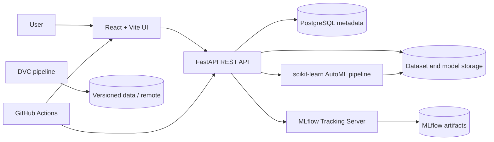
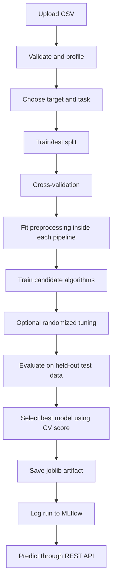

# AutoML Forge

An academic AutoML platform built with React, Vite, Tailwind CSS, FastAPI, SQLAlchemy, PostgreSQL, scikit-learn, MLflow, DVC, Docker Compose, and pytest.

> **Project status:** Working academic AutoML platform with JWT authentication, training with progress tracking, a voting ensemble, analytics and explainability pages, Docker and CI/CD. It is not a hardened multi-tenant production service; see Known limitations below. [`docs/AUDIT.md`](docs/AUDIT.md) is a historical audit log: its notes about a "demo stub" login are outdated.

## Features

**highlights**

- **Analytics page:** dataset quality scores, per-task algorithm performance charts, model comparison with task/algorithm/experiment filters, and prediction history.
- **Explainability page:** feature importance chart, confusion matrix and ROC curve (classification), residual plot (regression), and a downloadable evaluation report.
- **Dataset quality score** (0–100, from missing cells and duplicate rows) shown on every dataset profile, together with the dataset version and checksum.
- **Training progress percentage** with the current step, updated live while an experiment runs.
- **Voting ensemble:** every run also trains a soft-voting (classification) or averaging (regression) ensemble of the top three models; it can win "best model" like any other.
- **MLflow UI link** in the sidebar, settings and model cards (`MLFLOW_UI_URL`).
- Model and dataset version display.

**Platform**

- Modular data ingestion, validation, task detection, preprocessing, training, evaluation, and model selection modules under `backend/app/`.
- Standard service endpoints: `GET /health`, `GET /model-info`, and `POST /predict`, alongside the versioned `/api/...` routes.
- Best-effort MLflow tracking module and DVC reproducible training stage.

- CSV dataset upload with a configurable size limit and basic validation.
- Dataset schema, preview, missing-value counts, duplicate counts, and descriptive statistics.
- Automatic classification/regression task detection with manual override.
- Leakage-aware preprocessing pipelines for numerical and categorical features.
- Missing-value imputation, one-hot encoding, and numerical scaling.
- Classification and regression model comparison with cross-validation and held-out test metrics.
- Randomized hyperparameter search for Random Forest and Extra Trees.
- Model artifact serialization with joblib and API-based predictions.
- MLflow experiment tracking and model registration integration.
- PostgreSQL metadata storage, Docker Compose services, and a DVC validation pipeline.

## Technology stack

| Layer | Technology |
|---|---|
| Frontend | React 18, Vite, Tailwind CSS, Recharts |
| API | Python 3.11, FastAPI, Pydantic |
| Data | Pandas, NumPy |
| ML | scikit-learn, Joblib |
| Metadata | PostgreSQL, SQLAlchemy |
| MLOps | MLflow, DVC |
| Deployment | Docker, Docker Compose |
| Tests / CI | pytest, GitHub Actions |

## Architecture



## ML workflow



## Quick start with Docker Compose

1. Copy `.env.example` to `.env`.
2. Replace all development passwords before exposing services outside your machine.
3. Start the stack:

   ```bash
   docker compose up --build
   ```

4. Open:
   - Frontend: http://localhost:5173
   - API docs: http://localhost:8000/docs
   - API health: http://localhost:8000/api/health
   - MLflow: http://localhost:5000

The default account is for classroom demonstration (`demo@automl.local` / `demo123`). Login now returns a signed JWT and the dataset, experiment, model, and versioned prediction APIs require it. Set `JWT_SECRET` to a long random value before deployment.

## Local development

### Backend

```bash
cd backend
python -m venv .venv
# Windows: .venv\\Scripts\\activate
source .venv/bin/activate
pip install -r requirements.txt
```

Set `DATABASE_URL` to a reachable PostgreSQL database, or use `sqlite:///./automl.db` for local-only development. Then run:

```bash
uvicorn app.main:app --reload
```

### Frontend

```bash
cd frontend
npm install
npm run dev
```

Set `VITE_API_URL` to the API origin when it is not `http://localhost:8000`.

## API overview

| Method | Endpoint | Purpose |
|---|---|---|
| GET | `/` | API information |
| GET | `/health` | Container liveness |
| GET | `/model-info` | Metadata for the latest selected model |
| POST | `/predict` | Predict with the latest selected model |
| GET | `/api/health` | API and database readiness |
| POST | `/api/auth/login` | Login and receive JWT |
| POST | `/api/auth/register` | Create a user account |
| GET | `/api/auth/me` | Inspect the current user |
| GET | `/api/dashboard` | Dashboard counts and recent experiments |
| POST | `/api/datasets` | Upload CSV (multipart field `file`) |
| GET | `/api/datasets` | List datasets |
| GET | `/api/datasets/{dataset_id}` | Dataset profile and preview |
| POST | `/api/datasets/{dataset_id}/analyze` | Additional dataset analysis |
| GET | `/api/models/{model_id}/explain` | Feature importance, confusion matrix, ROC and residual data |
| GET | `/api/models/{model_id}/report` | Downloadable Markdown evaluation report |
| GET | `/api/analytics` | Dataset quality, algorithm statistics, experiment status counts |
| GET | `/api/predictions` | Prediction history (optional `model_id`) |
| GET | `/api/config` | UI configuration such as the MLflow URL |
| POST | `/api/experiments` | Queue model training |
| GET | `/api/experiments` | List experiments |
| GET | `/api/experiments/{experiment_id}` | Experiment status |
| GET | `/api/experiments/{experiment_id}/models` | Models from an experiment |
| GET | `/api/models` | List trained models (filter with `task_type`, `algorithm`, `experiment_id`) |
| GET | `/api/models/{model_id}` | Model metadata |
| POST | `/api/models/{model_id}/predict` | Predict rows with a saved model |

Prediction body example:

```json
{
  "rows": [
    {"age": 42, "city": "Agra", "income": 55000}
  ]
}
```

See the interactive OpenAPI schema at `/docs` for request and response models.

## Configuration

Configuration is loaded through Pydantic Settings. Important variables:

| Variable | Purpose |
|---|---|
| `DATABASE_URL` | SQLAlchemy database URL |
| `POSTGRES_DB`, `POSTGRES_USER`, `POSTGRES_PASSWORD` | Compose PostgreSQL initialization |
| `MLFLOW_TRACKING_URI` | MLflow tracking endpoint |
| `MLFLOW_EXPERIMENT_NAME` | Experiment namespace |
| `MLFLOW_UI_URL` | MLflow address shown as a link in the UI (default `http://localhost:5000`) |
| `UPLOAD_DIR` | Uploaded dataset directory |
| `MODEL_DIR` | Serialized model directory |
| `MAX_UPLOAD_MB` | CSV upload limit |
| `CORS_ORIGINS` | JSON array of permitted browser origins |
| `JWT_SECRET` | Secret used to sign access tokens |
| `ACCESS_TOKEN_MINUTES` | JWT lifetime |
| `VITE_API_URL` | API URL embedded in frontend build |

Never commit `.env` or production credentials. `.env.example` contains development defaults only.

## MLflow

The Docker Compose stack starts the MLflow tracking server at `http://localhost:5000`. For a local standalone tracking server, install the backend requirements and run:

```bash
cd backend
mlflow server --host 0.0.0.0 --port 5000 \\
  --backend-store-uri sqlite:///mlflow.db \\
  --default-artifact-root ./mlruns
```

Set `MLFLOW_TRACKING_URI` and `MLFLOW_EXPERIMENT_NAME` for the API process. Tracking and registration are best-effort: training remains available if MLflow is temporarily unavailable.

## DVC

The included `dvc.yaml` validates the sample classification CSV and runs a reproducible AutoML training stage. It writes a dataset profile, a DVC-tracked best pipeline, and evaluation metrics.

```bash
pip install -r backend/requirements.txt
# Initialize DVC once in a fresh clone if .dvc/ is not present
dvc init
dvc repro
# Inspect tracked metrics after the run
dvc metrics show
```

Configure a remote before sharing data or model outputs:

```bash
dvc remote add -d storage s3://your-bucket/automl-forge
```

Keep remote credentials outside Git. The bundled sample dataset is public demonstration data; put private uploads under `data/raw/` or in the configured runtime upload directory.

## Model monitoring and retraining

When a new labelled batch arrives, `scripts/monitor_and_retrain.py` validates it, evaluates the current champion model on it, retrains a candidate on old + new data (logged to MLflow) and runs a quality gate on weighted F1. The champion is only replaced with an explicit `--promote`, and every decision is recorded in `reports/model_decisions.jsonl`.

```bash
python scripts/monitor_and_retrain.py
```

Details, metric choice and results: [docs/MONITORING.md](docs/MONITORING.md).

## Tests

```bash
cd backend
pytest -q
```

The backend suite covers CSV loading and rejection, dataset profiling, task detection, missing/categorical preprocessing and unseen categories, baseline training, the voting ensemble, training progress, evaluation, best-model persistence, API startup and health.

- `tests/test_auth.py`: password hashing, login, registration, duplicate accounts, missing/invalid/expired/forged tokens, inactive users, and admin-only routes.
- `tests/test_explain.py`: feature importance for tree, linear and ensemble models, end-to-end training through the API, confusion matrix / ROC / residual data, the evaluation report, prediction history and model filtering.

Tests use a throwaway SQLite database and storage folder (`tests/conftest.py`), so they never touch your local data.

Frontend: `cd frontend && npm test && npm run build`.

## Cloud deployment notes

See [`cloud/README.md`](cloud/README.md). The repository contains deployment guidance, not cloud infrastructure provisioning. A production deployment still needs managed secrets, TLS, private networking, object storage, an external identity provider, tenant authorization, a durable job queue, observability, backup/restore, and resource limits.

## Known limitations

- The default account is intentionally a classroom seed; replace it and configure a strong JWT secret for public deployment.
- Alembic migrations are included; application startup still uses `create_all` for simple local setup.
- Dataset ownership is recorded and role checks are available, but a full tenant isolation policy is outside this academic scope.
- Training runs in FastAPI background tasks and are not durable across restarts.
- MLflow tracking and registration are best-effort integrations; operational failures are logged.
- DVC has a local pipeline scaffold but no configured remote.
- Training progress is kept in memory in the API process, so run the API with a single worker (the default) for live percentages.
- Explanations use model importances or permutation importance; SHAP is optional and not required.
- PostgreSQL, Docker Compose, and frontend production build require an environment with the relevant services and dependencies available.


## Modular backend usage

The backend modules can also be used directly from Python (run this snippet from `backend/`):

```python
import pandas as pd
from app.data_loader import load_csv
from app.data_validator import profile_dataset
from app.preprocessing import prepare_data
from app.model_trainer import train_models
from app.model_evaluator import evaluate_models
from app.model_selector import select_best_model

frame = load_csv("../data/sample_classification.csv")
print(profile_dataset(frame))
prepared = prepare_data(frame, target="purchased", task_type="auto")
trained = train_models(prepared.X_train, prepared.y_train, prepared.task_type)
comparison = evaluate_models(trained, prepared.X_test, prepared.y_test, prepared.task_type)
print(comparison)
```

The saved artifact includes the fitted preprocessing transformer and estimator. Prediction inputs must use the original feature column names.

## Run without Docker

```bash
cd backend
python -m venv .venv
# Windows: .venv\\Scripts\\activate
source .venv/bin/activate
pip install -r requirements.txt
uvicorn app.main:app --reload --host 0.0.0.0 --port 8000
```

Open `http://localhost:8000/docs`. The `GET /health` route is suitable for container liveness. `GET /api/health` also checks the metadata database connection.


## Team responsibilities

| Team member | Main modules / responsibilities |
|---|---|
| Member 1 — Data Processing & AutoML | `data_loader.py`, `data_validator.py`, `task_detector.py`, `preprocessing.py` |
| Member 2 — Machine Learning | `automl.py`, `model_trainer.py`, `metrics.py`, `model_evaluator.py`, `model_selector.py` |
| Member 3 — MLOps & Deployment | `mlflow_tracker.py`, `dvc.yaml`, `api.py` routes in `main.py`, Docker |
| Member 4 — Frontend & Integration | `frontend/`, API integration, CI workflow, `backend/tests/`, documentation |

## Troubleshooting

- **CSV rejected:** Confirm it is a UTF-8 `.csv` with a header row, at least two columns, unique non-empty column names, and within `MAX_UPLOAD_MB`.
- **Training says target is invalid:** Check that the target exists, contains at least two distinct non-null values, and that regression targets are numeric.
- **A model fails while others succeed:** Inspect the experiment model result error; individual candidate failures are recorded rather than stopping the full run.
- **MLflow is unavailable:** Check `MLFLOW_TRACKING_URI` and that the tracking server is reachable. Local training and saved Joblib predictions continue without MLflow.
- **DVC cannot reproduce:** Run `dvc init` once if the repository has no `.dvc/` directory, install the backend requirements, and run `dvc repro` from the repository root.
- **Frontend cannot reach the API:** Set `VITE_API_URL` to the API origin and ensure `CORS_ORIGINS` includes the frontend origin.
- **Docker API is unhealthy:** Inspect `docker compose logs api db mlflow` and confirm the database and tracking service have started.

## CI/CD

GitHub Actions (`.github/workflows/ci.yml`) runs on pushes and pull requests:

- **backend:** dependency install, Python compilation, pytest, API Docker image build.
- **frontend:** `npm ci`, smoke test, Vite production build.
- **compose:** builds and starts the Docker Compose stack, waits for the API health check, checks login, then shuts it down.
- **security:** `pip-audit` on backend requirements and `npm audit` on the frontend (report-only, so a newly published advisory does not block a demo).

`.github/workflows/cd.yml` publishes API and frontend images to GHCR on pushes to `main`.
