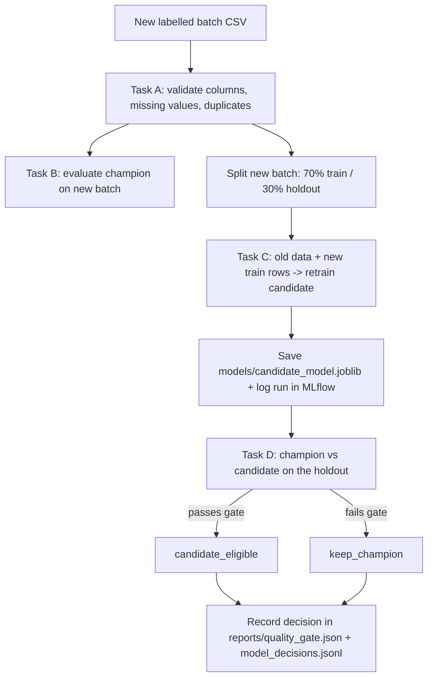

# Model monitoring and retraining

This extends AutoML Forge with a simple workflow for checking whether the
deployed (champion) model still performs well on newly labelled data, and
for retraining a candidate model when new data arrives.

Everything runs from one script:

```bash
pip install -r backend/requirements.txt
python scripts/monitor_and_retrain.py            # evaluate + retrain + quality gate
python scripts/monitor_and_retrain.py --promote  # same, and replace champion if the gate passed
```

It can also be run through DVC as the `monitor_retrain` stage (`dvc repro monitor_retrain`).
All settings are in the `monitoring` section of `params.yaml`.

## Workflow



### Task A: prepare new data

- File: `data/new_batch_classification.csv` (60 rows, same schema as the original training data).
- The required columns are taken from the champion itself (`feature_names_in_` + target), so a batch
  that does not match what the model expects is rejected straight away.
- Missing values are counted per column. Missing *feature* values are only reported because the
  pipeline already imputes them; rows with a missing target are dropped.
- Exact duplicate rows are counted and removed. (The dataset has no ID column, so duplicates are
  checked on full rows.)
- Dataset size and target distribution are printed and saved to `reports/new_batch_validation.json`.

### Task B: evaluate the existing model

- Loads the champion `models/dvc_best_model.joblib` (Logistic Regression pipeline from the DVC train stage).
- Predicts on the cleaned new batch and calculates Accuracy, Precision, Recall and F1 (weighted) using
  the existing `app.metrics.calculate_metrics`.
- Report saved to `reports/champion_evaluation.json`.

### Task C: retrain the model

- 30% of the new batch is kept aside as a holdout. The remaining 70% is combined with the original
  training data (`data/sample_classification.csv`).
- The candidate is trained with `sklearn.base.clone(champion)`, i.e. the **same preprocessing pipeline**
  (median/most-frequent imputation, scaling, one-hot encoding) and the same algorithm settings,
  just refitted on more data.
- Saved separately as `models/candidate_model.joblib`; the champion file is not touched.
- The run is logged to MLflow (params, champion/candidate holdout metrics, the candidate artifact).
  If `MLFLOW_TRACKING_URI` is not set it uses a local `mlflow.db`; view it with
  `mlflow ui --backend-store-uri sqlite:///mlflow.db`.

### Task D: quality gate

Both models are scored on the **same holdout rows**, which neither of them was trained on. Comparing
on rows the candidate had already seen would make it look better than it is.

Rule (`backend/app/monitoring.py::quality_gate`):

| Check | Value |
|---|---|
| candidate F1 ≥ `min_score` | 0.75 |
| candidate F1 − champion F1 ≥ `min_improvement` | 0.01 |

If both checks pass the decision is `candidate_eligible`, otherwise `keep_champion`.
The champion is never replaced automatically. Replacing it needs `--promote`, and even then only
when the gate passed; the old champion is copied to `models/archive/` first. Every run, promoted
or not, is appended to `reports/model_decisions.jsonl`.

#### Why weighted F1?

- **The classes are imbalanced.** The new batch is about 71% "yes" / 29% "no". Accuracy can stay high
  just by predicting the majority class, so it hides problems with the minority class.
- **Both kinds of error cost something.** A false negative is a customer who would have bought but was
  missed, and a false positive is marketing effort spent on someone who will not buy. F1 balances
  precision and recall instead of optimising one of them.
- **It matches how the champion was chosen.** AutoML training already selects models on `f1_weighted`
  (`params.yaml`), so the champion and the candidate are judged on the same criterion.
- The 0.75 floor stops a candidate that is "better" but still not good enough, and the 0.01 margin
  avoids swapping models over noise on a small holdout.

## Results of the demo run

From `reports/monitoring_run.log`:

```
[A] new batch: 60 rows -> 58 after removing 2 duplicates
    missing values: {'age': 0, 'income': 1, 'city': 1, 'purchased': 0}
    target distribution: {'yes': 41, 'no': 17}
[B] champion on new batch: accuracy=0.793, precision=0.840, recall=0.793, f1=0.802
[C] candidate trained on 59 rows (20 old + 40 new), saved to models/candidate_model.joblib
[D] holdout f1: champion=0.889 candidate=0.942 -> candidate_eligible
```

- The champion dropped from F1 1.0 on its original test split to 0.80 on the new batch. In the new
  data customers start buying at a lower income (~39k instead of ~45k), and the old model misses
  many of those buyers (recall for "yes" ≈ 0.76).
- The candidate, trained with the new rows included, scores 0.942 F1 on the holdout vs 0.889 for the
  champion: +0.053, above both thresholds, so it is marked **eligible for promotion**.
- The champion was not replaced in this run (`"promoted": false`); promotion is a separate, recorded step.

## Output files

| File | Content |
|---|---|
| `reports/new_batch_validation.json` | Task A: size, missing values, duplicates, target distribution |
| `reports/champion_evaluation.json` | Task B: champion metrics on the new batch |
| `models/candidate_model.joblib` | Task C: candidate model artifact |
| `reports/quality_gate.json` | Task D: both models' holdout metrics, checks and the decision |
| `reports/model_decisions.jsonl` | History of every gate decision / promotion |
| `reports/monitoring_run.log` | Console output of the demo run |

## Limitations

- The data is small (20 original rows, 60 new), so holdout metrics move a lot with a few rows. The
  thresholds would need to be revisited with real data volumes.
- The candidate reuses the champion's algorithm. Running the full AutoML search on the combined data
  is possible (`app.automl.train_all`) but was kept out to keep the comparison simple.
- The trigger is manual (run the script when a new batch arrives); it is not scheduled.
